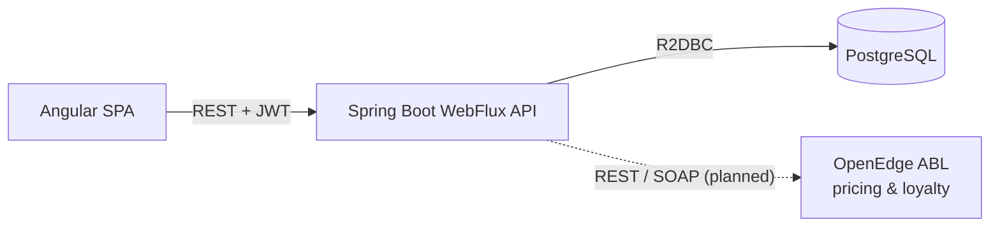
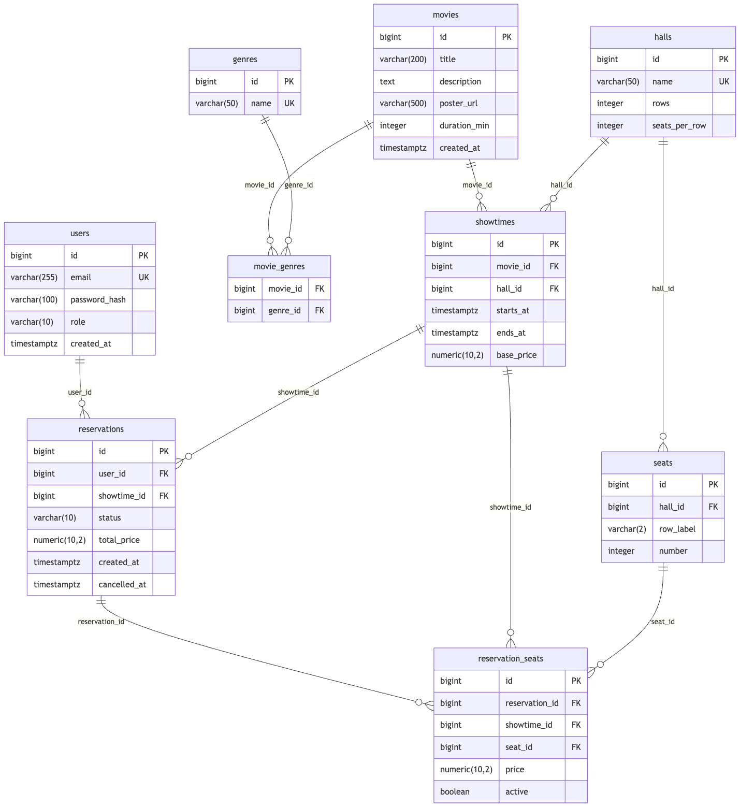

# Movie Reservation System

A backend (and soon a frontend) for reserving movie tickets. Users sign up, browse movies and showtimes, pick seats and manage their reservations. Admins manage movies, schedule showtimes and see capacity and revenue reports.

It's based on the [roadmap.sh Movie Reservation System](https://roadmap.sh/projects/movie-reservation-system) project. I'm building it to get hands-on experience with an enterprise Java stack: reactive Spring, Angular, CI/CD with Jenkins, OpenShift, and integration with an OpenEdge ABL service.

> **Status:** work in progress. The database, project setup, authentication with roles, and movie management are done. Showtimes, reservations and reports are next. See the [roadmap](#roadmap).

## Tech stack

| Area | Technology |
|---|---|
| Backend | Java 25, Spring Boot 4 (WebFlux, reactive), Spring Data R2DBC, Spring Security (JWT resource server), Bean Validation |
| Database | PostgreSQL 17, Flyway migrations |
| Testing | JUnit 5, WebTestClient, Testcontainers |
| Code quality | Spotless + palantir-java-format, JSpecify null-safety (`@NullMarked`) |
| Frontend *(planned)* | Angular, TypeScript, Angular Material |
| DevOps *(planned)* | Docker, Jenkins, OpenShift Local |
| Integration *(planned)* | OpenEdge ABL pricing service called via REST and SOAP |

## Architecture



The backend is organised **by feature**, not by layer: `auth`, `user`, `genre`, `movie`, `common`, and later `showtime`, `reservation`, `report`. Each feature package holds its own controller, service, repository and DTOs.

## Key design decisions

### No double-booking: enforced by the database
Two users can click "Reserve" on the same seat at the same moment. Checking whether a seat is free and then inserting is a race condition, so the rule lives in PostgreSQL instead:

```sql
CREATE UNIQUE INDEX ux_seat_once_per_showtime
    ON reservation_seats (showtime_id, seat_id)
    WHERE active;
```

The index is **partial** (`WHERE active`), so a cancelled seat can be booked again while the cancelled reservation stays in the history for reports. A violation (`23505`) is turned into **409 Conflict**.

### No overlapping showtimes in a hall
An exclusion constraint rejects any showtime whose time range overlaps another one in the same hall:

```sql
ALTER TABLE showtimes ADD CONSTRAINT no_overlap_in_hall
    EXCLUDE USING gist (hall_id WITH =, tstzrange(starts_at, ends_at) WITH &&);
```

Showtimes that run back to back are allowed, because ranges exclude their end.

### Authentication
- Passwords are hashed with **BCrypt**. Hashing runs on a separate scheduler so it doesn't block the reactive event loop.
- Login returns a signed **JWT** (HS256) with the user id as `sub` and a `roles` claim. Spring Security's OAuth2 resource server validates it on every request.
- `/api/admin/**` requires the `ADMIN` role. The first admin is created at startup from configuration, not committed to a migration.
- Login gives the same error for an unknown email and a wrong password, so it doesn't reveal which emails are registered.

### Movies and genres without an ORM
R2DBC has no relationship mapping, so the `movie_genres` join table is written with plain SQL through `DatabaseClient`. Creating or updating a movie and its genre links happens in one transaction. Lists are read with a single join (no N+1 queries) and grouped back into movies. Paging selects the page of *movies* first in a CTE, so a movie with several genres is never split across pages. Search conditions are built dynamically, but every value is bound as a parameter, never concatenated into the SQL.

### Errors
Every error response uses the [RFC 7807](https://www.rfc-editor.org/rfc/rfc7807) `ProblemDetail` format (`application/problem+json`). Validation errors include a field → message map.

## Data model



Tables: `users`, `genres`, `movies`, `movie_genres`, `halls`, `seats`, `showtimes`, `reservations`, `reservation_seats`. The schema lives in [`backend/src/main/resources/db/migration`](backend/src/main/resources/db/migration).

## Getting started

### Prerequisites
- JDK 25
- Docker (with Docker Compose)

### 1. Start PostgreSQL
Create `infra/.env` (it's git-ignored):

```dotenv
DB_NAME=movie_reservation
DB_USER=admin
DB_PASSWORD=password
```

Then run:

```bash
docker compose -f infra/docker-compose.yml up -d
```

### 2. Run the backend

```bash
cd backend
./mvnw spring-boot:run
```

Flyway creates the schema and seed data on first start. The API runs on `http://localhost:8080`, and `GET /actuator/health` should return `{"status":"UP"}`.

### Configuration
The defaults in `application.yaml` are for **local development only**. Override them with environment variables everywhere else:

| Variable | Purpose |
|---|---|
| `DB_USER`, `DB_PASSWORD` | Database credentials |
| `JWT_SECRET` | Base64-encoded HMAC key, at least 256 bits (`openssl rand -base64 32`) |
| `ADMIN_EMAIL`, `ADMIN_PASSWORD` | The admin account created at startup if it doesn't exist |
| `POSTERS_DIR` | Folder where uploaded posters are stored (default `./data/posters`) |

### 3. Run the tests

```bash
cd backend
./mvnw verify
```

The integration tests start a throwaway PostgreSQL with Testcontainers (Docker must be running). `verify` also runs `spotless:check`. To format the code, run `./mvnw spotless:apply`.

## API

| Method | Path | Access | Description |
|---|---|---|---|
| `POST` | `/api/auth/signup` | public | Create an account (role `USER`) |
| `POST` | `/api/auth/login` | public | Get a JWT |
| `GET` | `/api/users/me` | logged in | The current user |
| `GET` | `/api/genres` | public | List genres |
| `GET` | `/api/genres/{id}` | public | One genre |
| `GET` | `/api/movies` | public | Paged list of movies with genres; filters `q` (title search) and `genreId`, paging `page`, `size` (max 100) |
| `GET` | `/api/movies/{id}` | public | One movie with its genres |
| `GET` | `/posters/{file}` | public | Poster image |
| `GET` | `/api/admin/users` | admin | List all users |
| `PATCH` | `/api/admin/users/{id}/role` | admin | Change a user's role |
| `POST` | `/api/admin/movies` | admin | Create a movie with genres |
| `PUT` | `/api/admin/movies/{id}` | admin | Update a movie and replace its genres |
| `DELETE` | `/api/admin/movies/{id}` | admin | Delete a movie (409 if it has showtimes) |
| `PUT` | `/api/admin/movies/{id}/poster` | admin | Upload or replace the poster (multipart, JPEG/PNG/WebP, max 5 MB) |
| `GET` | `/actuator/health` | public | Health check |

Example:

```bash
curl -X POST localhost:8080/api/auth/signup -H 'Content-Type: application/json' \
     -d '{"email":"user@example.com","password":"supersecret"}'

TOKEN=$(curl -s -X POST localhost:8080/api/auth/login -H 'Content-Type: application/json' \
     -d '{"email":"user@example.com","password":"supersecret"}' | sed -E 's/.*"token":"([^"]+)".*/\1/')

curl localhost:8080/api/users/me -H "Authorization: Bearer $TOKEN"
```

## Roadmap

- [x] Database schema with constraints against double-booking and overlapping showtimes
- [x] Spring Boot WebFlux skeleton, Flyway, error handling, integration tests
- [x] Signup, login with JWT, roles, admin seeding
- [x] Admin user management (list users, promote to admin)
- [x] Movies and genres management, paging and search, poster upload
- [ ] Halls and showtime scheduling
- [ ] Seat map, reservations and cancellation, plus a concurrency test
- [ ] Admin reports: reservations, occupancy, revenue
- [ ] Logging and observability
- [ ] Angular frontend
- [ ] Docker images, Jenkins pipeline, OpenShift deployment
- [ ] OpenEdge ABL pricing service (REST and SOAP)

## Repository layout

```
backend/   Spring Boot application (Maven)
frontend/  Angular application (planned)
infra/     docker-compose, and later Jenkins and OpenShift files
docs/      ER diagram, schema draft, design notes
```
